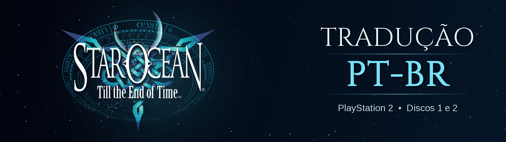
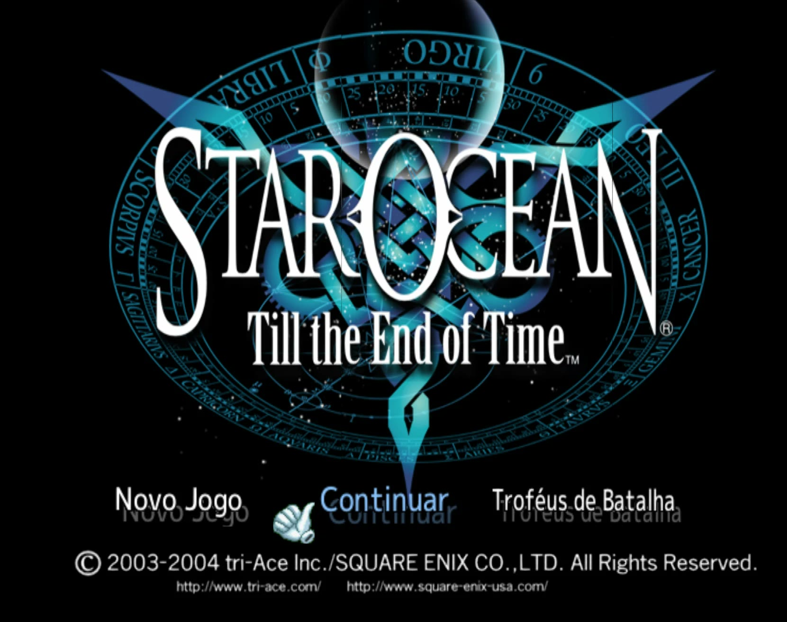
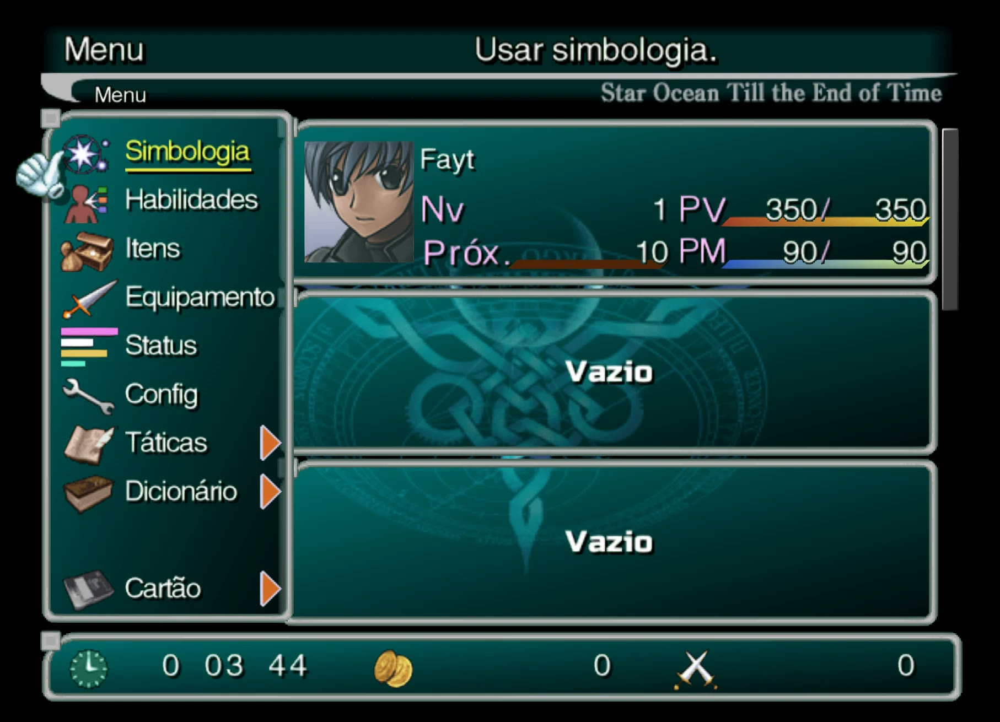
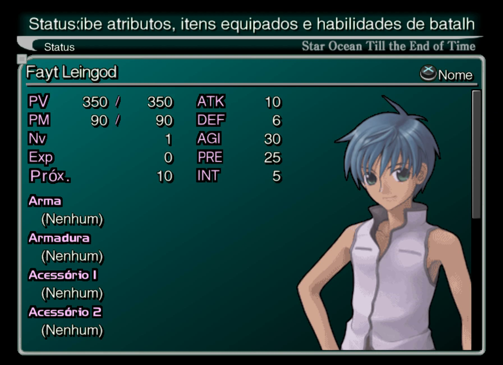
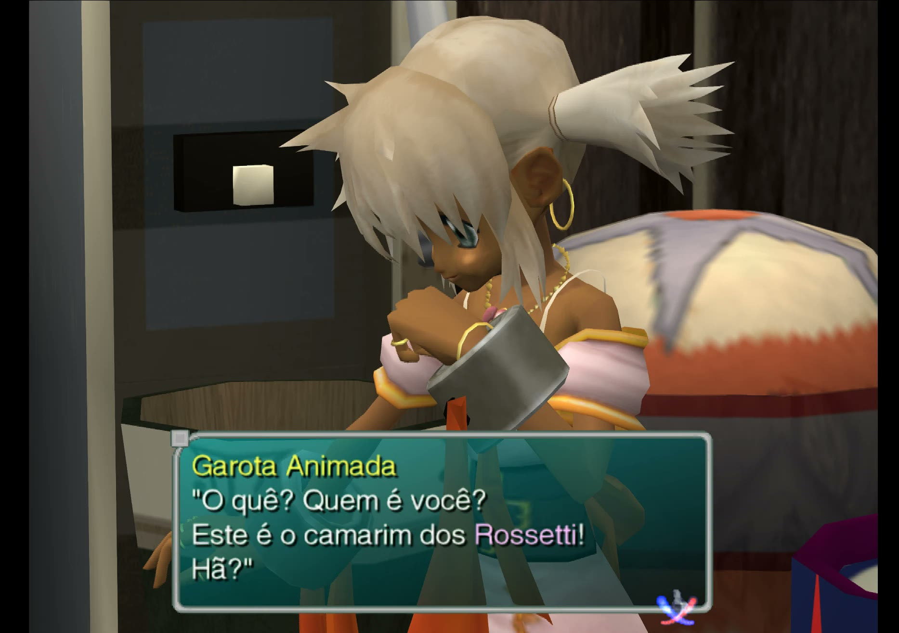
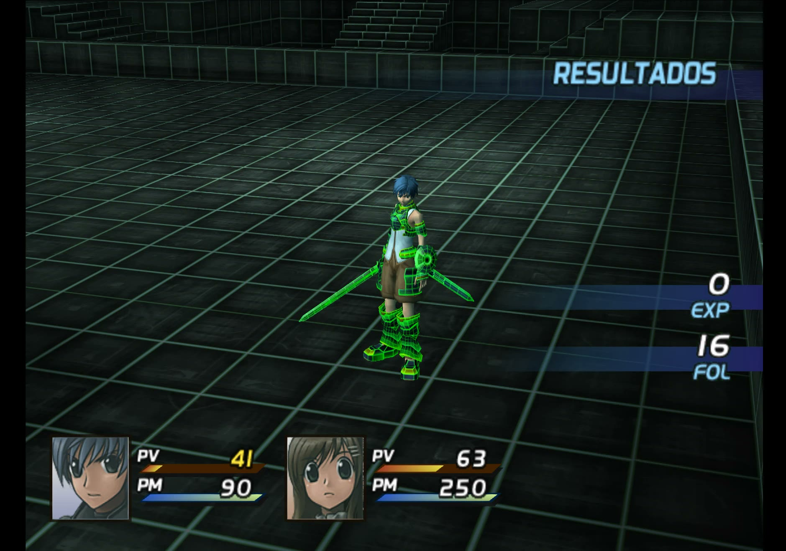

# 🌌 Star Ocean: Till the End of Time — Tradução PT-BR v1.3

-009c3b)
-003791)
-555)


Tradução de fã do **Star Ocean: Till the End of Time** (PlayStation 2, versão americana) para o **português do Brasil**,
nos **dois discos**.

*Feita por fãs, para fãs. Gratuita, sem fins lucrativos e sem nenhuma ligação com a Square Enix ou a tri-Ace
(veja o aviso legal no fim desta página).*

> ✅ Os dois discos estão traduzidos, e todos os diálogos foram revisados com o contexto da história e o jeito de falar
> de cada personagem. **Na v1.3, todo o texto (falas, itens, habilidades, Dicionário e menus) foi revisado de novo
> comparando com o japonês da versão Director's Cut**: gênero e tratamento dos personagens, nomes com sentido duplo
> no inglês e palavras que tinham tradução direta. *Atualizada em 09/11/2026: "Energy Burst" agora é "Surto de Energia"
> e o talento "Compounding" agora é "Manipulação", como no Star Ocean 5.* Testado no PCSX2. Se achar algum problema, abra uma [issue](../../issues).

## 📸 Fotos

| | |
|---|---|
|  |  |
| Tela de título | Menu principal |
|  |  |
| Status do Fayt | Conversa com a Peppita |
|  |  |
| Golpe especial na batalha | Resultados da batalha |

*Fotos da versão Nomes Traduzidos, no emulador PCSX2.*

## 📥 Download (v1.3)

**[⬇️ Baixar `SO3_PTBR_v1.3.zip`](../../releases/latest)**: as **duas versões** da tradução (patches xdelta dos dois
discos), o guia `LEIA-ME.txt`, os códigos para conferência e os termos de uso.

| Dentro do zip | Para | SHA-256 |
|---|---|---|
| `NomesTraduzidos/SO3_PTBR_Disco1.xdelta` | Nomes Traduzidos, disco 1 | `43b61b37d5cecad19d5e2c7995a05e4d5aa3aaa3dc568bddb4d186061aa06092` |
| `NomesTraduzidos/SO3_PTBR_Disco2.xdelta` | Nomes Traduzidos, disco 2 | `5c2fdb561ee3bd3f70d0be2037bf73380919c397a9cc766971a6fb79bac59d58` |
| `NomesOriginais/SO3_PTBR_NomesOriginais_Disco1.xdelta` | Nomes Originais, disco 1 | `7fca59d5dc0e7e4fbd494f0a9cbcc6f04151e8588be92cd2a7c9677b55ecf430` |
| `NomesOriginais/SO3_PTBR_NomesOriginais_Disco2.xdelta` | Nomes Originais, disco 2 | `9f07751e5456b424a84a230a7ebe9260f089e1afa68cacf285bb5214c378c675` |

Como aplicar: veja **Instalação**, mais abaixo.

## 🎭 Duas versões: escolha a sua

| | **Nomes Traduzidos** | **Nomes Originais** |
|---|---|---|
| Menus e telas | Português | Português |
| História, diálogos e mensagens | Português | Português |
| Descrições (itens, habilidades, magias, Dicionário) | Português | Português |
| Piadas e trocadilhos dentro das falas | Recriados em português | Recriados em português |
| Habilidades e golpes | Português (*Queda Estelar, Golpe de Investida*) | Originais (*Star Fall, Charge Strike*) |
| Magias (Simbologia) | Português (*Rajada de Fogo, Agulhas de Gelo*) | Originais (*Fire Bolt, Ice Needles*) |
| Itens | Português (*Pedra Filosofal, Scanner Quádruplo*) | Originais (*Philosopher's Stone, Quad Scanner*) |
| Armas e equipamentos | Português (*Espada Malfeita, Malha de Mitril*) | Originais (*Botched Sword, Mythril Mesh*) |
| Monstros e duplas da Arena | Português (*Cocatriz, Vox Poderoso, Rainha Etérea, Dupla Vilã*) | Originais (*Cockatrice, Mighty Vox, Ethereal Queen, Villain Pair*) |
| Troféus de batalha | Português | Frase em português, nomes originais (*"Vença só com Charge"*, *"Derrote o Giant Crab em 1min"*) |
| Lugares (mapas e cidades), inclusive os de nome comum | Português (*Castelo Aquaria, Base Lunar, Sala de Transporte*) | Originais (*Castle Aquaria, Moonbase, Transporter Room*) |
| Lojas e seus donos, e lugares só citados | Português (*Batata Jack, Cortina de Ferro, Estrada do Dragão*) | Português (iguais) |
| Regiões que não são mapa (reinos, impérios, continentes, setores, sistemas) | Português (*Reino de Airyglyph, Setor Teta, Sistema Solar*) | Português (iguais) |
| Nomes que são trocadilho (Batalhicóptero, Fuliginho, Bicolor, Tempestade) | Português | Originais (*Battlecopter, Sootie, Oddeye, Tempest*) |
| Nome próprio com forma em português | Português (*Aldiano, Ronaldo Dyne*) | Originais (*Aldian, Ronald Dyne*) |
| Nomes próprios (Fayt, Elicoor II, Airyglyph, Diplo…) | Iguais | Iguais |
| Organizações (Brigada Negra, Federação Pangaláctica, Igreja de Apris) | Português | Português (iguais) |
| Termos do mundo (Esfera Eterna, Portal do Tempo, runologia) | Português | Português (iguais) |
| Títulos com nome (o título se traduz, o nome não) | Português (*Rei Airyglyph, Senhora Clair, Conde Woltar*) | Português (iguais) |
| Títulos dos verbetes do Dicionário | Português | Português (iguais) |
| Raças de palavra comum (Humano, Povo-Fera, Montanhês) e tipos de nave | Português | Português (iguais) |
| Raças com nome inventado (Vendeeni, Greem, Menodix) | Iguais | Iguais |
| Siglas de status | **PV, PM**, Nv, Próx., ATQ, PC, PH | **HP, MP** (combinam com o HUD original), Nv, Próx., ATQ, PC, PH |
| Imagens com texto (título, configurações, HUD da batalha, Oficina, Fim de Jogo) | Traduzidas | Originais (inglês) |

- **Nomes Traduzidos:** o jogo todo em português. Só os nomes próprios ficam como no original, mas o título que vem
  com eles se traduz ("King Airyglyph" = "Rei Airyglyph").
- **Nomes Originais:** para quem joga com guia, wiki ou fórum em inglês. É igual à Nomes Traduzidos, menos o que se
  procura num guia: os nomes de **cidades e mapas, itens, equipamentos, habilidades, magias e monstros** (e os
  trocadilhos dessas coisas) ficam como no original, além das imagens. Todo o resto continua em português: menus, história,
  descrições, Dicionário, lojas, organizações, termos do mundo e títulos com nome. A frase em volta segue em português
  ("Fayt aprende Star Fall!", "a Brigada Negra ataca Arias", "o Rei Airyglyph espera no Airyglyph Castle").

As duas usam as mesmas ISOs originais e o mesmo cartão de memória: dá para trocar de versão a qualquer momento.

## 🎮 O que foi traduzido

| Parte | Disco 1 | Disco 2 | Cobertura |
|---|---|---|---|
| Diálogos e cenas (falas) | 42.676 | 40.893 | 100% |
| Menus, itens, habilidades, criação, Dicionário, sistema | 27.693 | 27.760 | 100% |
| Imagens com texto (título, configurações, batalha, Oficina, avisos) | 17 texturas | as mesmas | 100% das encontradas |

*As contagens incluem textos repetidos em vários lugares do jogo. Em textos diferentes, são cerca de 22 mil por disco.*

- **Contexto da história:** cada fala foi revisada sabendo em que ponto da aventura está, quem está falando e o que
  cada personagem já sabe. Quando o inglês faz piada ou trocadilho, a piada foi refeita em português.
- **Cada personagem fala do seu jeito:** o Albel é arrogante e chama todo mundo de verme, o Roger é moleque e se diz
  "homem de verdade", a Nel é formal e contida, o Cliff é debochado, a Peppita é falante, a Maria é direta.
- **Acentos e cedilha** desenhados na fonte do jogo (á, ã, ç, é, ê, õ…), além de ‘ º ª.
- **Medidas no lugar:** cada caixa de diálogo foi conferida pixel a pixel para o texto caber no espaço original.
- **Glossário único:** naves no feminino ("a Diplo"), termos padronizados, nomes de itens e golpes vindos de uma lista
  mestre conferida com guias do jogo.
- **Textos desenhados em letras do próprio jogo** refeitos no mesmo estilo: rótulos de menu (Nv, PV, PM, ATQ…), os sete
  Livros Antigos, o fim de partida do tabuleiro das Ruínas de Mosel e o terminal da Blair.

## 🚫 O que não foi traduzido (de propósito)

| O quê | Por quê |
|---|---|
| Nomes de personagens (Fayt, Sophia, Cliff, Albel…) | São nomes próprios, iguais em todas as versões do jogo. |
| Nomes de naves e planetas (Diplo, Eagle, Elicoor II, Vanguard III…) | Nomes próprios. As naves aparecem no feminino ("a Diplo"). |
| Raças inventadas (Vendeeni, Greem, Menodix…) | Não existem em português. Raças descritivas foram traduzidas (Povo-Fera, Montanhês…). |
| Vozes e dublagem | Ficam as vozes originais em inglês. |
| Vídeos (FMV) e créditos finais | Vídeos pré-renderizados. |
| "Dolby Pro Logic II", logotipos e copyright | Marcas registradas. |
| Escrita alienígena e rótulos decorativos dos cenários | Fazem parte da arte do jogo. |

**Ainda falta (não é de propósito):** algumas placas desenhadas nos cenários e a lista de arenas do Modo Batalha
(versus). Se encontrar outra coisa em inglês, abra uma issue.

## 💿 O que você precisa

Você precisa das suas **próprias ISOs** da versão americana (NTSC-U). **Este projeto não distribui o jogo.**

| Disco | Arquivo esperado | Tamanho (bytes) | CRC32 | SHA-1 |
|---|---|---|---|---|
| 1 | Star Ocean - Till the End of Time (USA) (Disc 1).iso | 4658429952 | `42d02704` | `efddee8f359738887a688847d80d32bbf10a059f` |
| 2 | Star Ocean - Till the End of Time (USA) (Disc 2).iso | 4658692096 | `1974e922` | `e9f7a686072bc414758e683165d3c786d4b32960` |

## 💾 Instalação

1. Baixe o `SO3_PTBR_v1.3.zip` na página de [Releases](../../releases) e descompacte.
2. Escolha **uma** versão: a pasta `NomesTraduzidos` ou a pasta `NomesOriginais`.
3. **Faça uma cópia** das suas ISOs originais.
4. Aplique o patch de cada disco da versão escolhida:
   - **🪟 Windows:** abra o [Delta Patcher](https://github.com/marco-calautti/DeltaPatcher). Em *Original file*,
     escolha a **cópia** da ISO; em *XDelta patch*, o `.xdelta` do mesmo disco. Depois clique em *Apply patch*.
     O Delta Patcher grava o resultado **por cima** do arquivo escolhido, por isso use a cópia.
   - **🐧 Linux/macOS** (exemplo com Nomes Traduzidos):
     ```
     xdelta3 -d -s "Star Ocean - Till the End of Time (USA) (Disc 1).iso" NomesTraduzidos/SO3_PTBR_Disco1.xdelta SO3_PTBR_Disco1.iso
     xdelta3 -d -s "Star Ocean - Till the End of Time (USA) (Disc 2).iso" NomesTraduzidos/SO3_PTBR_Disco2.xdelta SO3_PTBR_Disco2.iso
     ```
5. (Opcional) Confira a ISO traduzida:

   | Versão | Disco | Tamanho (bytes) | CRC32 | SHA-1 |
   |---|---|---|---|---|
   | Nomes Traduzidos | 1 | 4658429952 | `e6da249e` | `7c2282b9a8daf7e75abe98b97a10a50e89c2b999` |
   | Nomes Traduzidos | 2 | 4658692096 | `3a80e674` | `e7ac12e46c35ca5789733c010d3310c3ef8dd68b` |
   | Nomes Originais | 1 | 4658429952 | `4c6c2199` | `08178ad6f20abea799de551d5fb75dfe1a29161e` |
   | Nomes Originais | 2 | 4658692096 | `2848883e` | `a4fccb1ae0641597599fc977c236f88fe00945e6` |

6. Abra a ISO traduzida no PCSX2. Saves do jogo em inglês funcionam normalmente, nas duas versões.

**Para trocar de versão**, aplique o patch da outra versão numa nova cópia das ISOs originais (o patch é sempre aplicado
na ISO original, nunca numa ISO já traduzida).

## 🔒 Segurança e verificação

- Baixe os patches **só pela página de [Releases](../../releases) deste repositório**.
- Confira o SHA-256 do `.xdelta` com a tabela de Download (ou use o `SHA256SUMS.txt` do pacote):
  - Windows: `certutil -hashfile SO3_PTBR_Disco1.xdelta SHA256`
  - Linux/macOS: `sha256sum -c SHA256SUMS.txt`
- Faça backup do seu cartão de memória (`Mcd001.ps2`, na pasta `memcards` do PCSX2) antes de jogar.

## ❓ Não funcionou?

| Sintoma | Causa provável |
|---|---|
| O Delta Patcher dá erro de checksum ou "source file" | A ISO não é a americana original 1:1 (ou já foi traduzida antes). Confira o CRC32/SHA-1 da tabela acima. |
| Textos misturados (parte em inglês, parte em português) depois de atualizar ou trocar de versão | Você carregou um *save state* de outra versão. Reinicie o jogo e continue pelo save do cartão de memória. |
| O disco 2 não é aceito na troca de disco | Aplique o patch do disco 2 na ISO do **disco 2**, da mesma versão usada no disco 1. |
| Tela preta ou travamento | Abra uma issue informando onde aconteceu. |

## 🐞 Achou um erro?

Abra uma [issue](../../issues/new/choose) usando o formulário "Erro na tradução". Informe a versão (Nomes Traduzidos ou
Nomes Originais), o disco, o lugar do jogo e, se puder, mande um print. Toda correção de português também é bem-vinda.

## 🙏 Créditos

- **Tradução, revisão e ferramentas:** [0xdhx0](https://github.com/0xdhx0).
- **Engenharia reversa do formato do disco:** baseada no
  [Star-Ocean-3-ps2-research-toolkit](https://github.com/Starocean101/Star-Ocean-3-ps2-research-toolkit).
- **Fontes livres (licença OFL)** usadas nas imagens: Arimo, Russo One, Tinos, Cinzel, Orbitron, M PLUS 1p.

**Como foi feita:** a tradução usou ferramentas de IA. Todos os diálogos foram revisados com o contexto da história e o
jeito de falar de cada personagem, conferidos pixel a pixel para caber nas caixas e testados no PCSX2. Se achar uma
frase estranha, abra uma [issue](../../issues), porque toda sugestão ajuda.

## ⚖️ Aviso legal e uso

- Esta é uma **tradução feita por fãs, para fãs**, **gratuita** e **sem fins lucrativos**.
- **Não temos nenhuma ligação** com a Square Enix, a tri-Ace ou qualquer outra empresa envolvida no jogo. O projeto não
  é oficial, nem aprovado ou apoiado por elas.
- *Star Ocean: Till the End of Time* e todos os nomes, marcas e personagens pertencem aos seus donos
  (© SQUARE ENIX / tri-Ace).
- O patch contém **apenas as diferenças** em relação ao jogo original e **não funciona sem uma cópia do jogo**. Nenhum
  arquivo do jogo é distribuído aqui. Não peça nem compartilhe ISOs neste repositório.
- Pode usar e compartilhar o patch à vontade, **de graça**. Ele **não pode ser vendido** nem monetizado. Se alguém
  cobrou por ele, você foi enganado. Veja [LICENSE.txt](LICENSE.txt).
- Se você é detentor de algum direito e quer que algo seja retirado, abra uma issue ou entre em contato pelo GitHub.

Apoie a franquia comprando os jogos oficiais.
