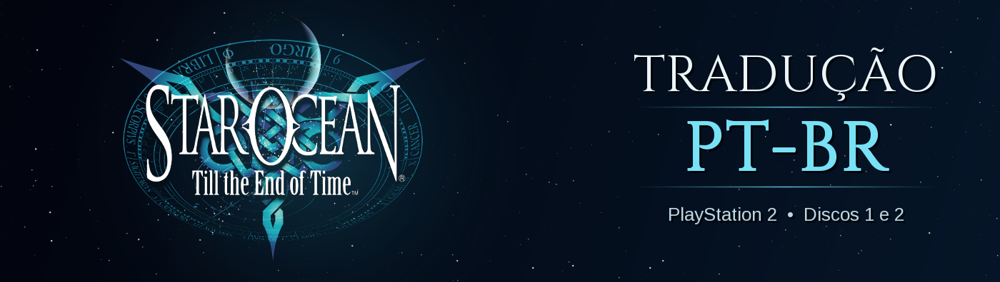

# 🌌 Star Ocean: Till the End of Time — Tradução PT-BR v0.9 (beta)

-009c3b)
-003791)
-555)


Tradução de fã do **Star Ocean: Till the End of Time** (PlayStation 2, versão americana) para o **português do Brasil**.

*Feita por fãs, para fãs. Gratuita, sem fins lucrativos e sem nenhuma ligação com a Square Enix ou a tri-Ace
(veja o aviso legal no fim desta página).*

> ⚠️ **Beta.** O disco 1 foi jogado e testado no PCSX2. O disco 2 está todo traduzido, mas **ainda não foi testado no
> emulador**. Se achar algum problema, abra uma [issue](../../issues).

## 📥 Download (v0.9 beta)

**[⬇️ Baixar `SO3_PTBR_v0.9-beta.zip`](../../releases/latest)**: os patches dos dois discos, o guia `LEIA-ME.txt`
e os códigos para conferência.

| Arquivo dentro do zip | Para | SHA-256 |
|---|---|---|
| `SO3_PTBR_Disco1.xdelta` | Disco 1 | `feb7fad0dc1c29bee98c6536472ee1fb7d765353ab0b99a4acdba2b50348bbc5` |
| `SO3_PTBR_Disco2.xdelta` | Disco 2 | `6306beb05a096f59d3232d73e1c7c3fe8b45a1bc55ffc75b409be45546fbd12f` |

Todas as versões estão em [Releases](../../releases). Como aplicar: veja **Instalação**, mais abaixo.

## 🆕 Novidades da v0.9

- Primeira versão pública, com os **dois discos** traduzidos.
- Textos revisados um a um, com o contexto da história: tom de cada personagem, gênero das falas (naves no feminino,
  por exemplo) e termos padronizados.
- HUD da batalha redesenhado: Fúria, Batalha Bônus, Ataque Especial, Escolha o Alvo.

## 🎮 O que foi traduzido

| Parte | Disco 1 | Disco 2 | Cobertura |
|---|---|---|---|
| Diálogos e cenas (falas) | 42.676 | 40.893 | 100% |
| Menus, itens, habilidades, criação, enciclopédia, sistema | 27.693 | 27.760 | 100% |
| Imagens com texto (título, configurações, batalha, Oficina, avisos) | 17 texturas | as mesmas | 100% das encontradas |

*As contagens incluem textos repetidos em vários lugares do jogo. Em textos diferentes, são cerca de 22 mil por disco.*

- **Acentos e cedilha** desenhados na fonte do jogo (á, ã, ç, é, ê, õ…), além de ‘ º ª.
- **Medidas no lugar:** cada caixa de diálogo foi conferida pixel a pixel para o texto caber no espaço original.
- **Personagens com voz própria:** o Albel é arrogante, o Roger é moleque, a Nel é formal… Nomes de lugares, naves e
  raças seguem um glossário único.
- **Termos:** HP/MP viraram **PV/PM**. Nomes de itens e golpes vêm de uma lista mestre única.
- **Rótulos de menu** desenhados no estilo da fonte original (Nv, PV, PM, ATQ…).

<!-- ## 🖼️ Imagens
Colocar prints em imagens/ e listar aqui, por exemplo:
| | |
|---|---|
|  |  |
-->

## 🚫 O que não foi traduzido (de propósito)

| O quê | Por quê |
|---|---|
| Nomes de personagens (Fayt, Sophia, Cliff, Albel…) | São nomes próprios, iguais em todas as versões do jogo. |
| Nomes de naves e planetas (Diplo, Eagle, Elicoor II, Vanguard III…) | Nomes próprios. As naves aparecem no feminino ("a Diplo"). |
| Raças inventadas (Vendeeni, Greem, Menodix…) | Não existem em português. Raças descritivas foram traduzidas (Povo-Fera, Montanhês…). |
| Vozes e dublagem | Ficam as vozes originais em inglês. |
| Vídeos (FMV) e créditos finais | Vídeos pré-renderizados. |
| "Dolby Pro Logic II", logotipos e copyright | Marcas registradas. |
| Escrita alienígena e rótulos decorativos dos cenários | Fazem parte da arte do jogo. |

**Ainda falta (não é de propósito):** algumas placas desenhadas nos cenários e a lista de arenas do Modo Batalha
(versus). Se encontrar outra coisa em inglês, abra uma issue.

## 💿 O que você precisa

Você precisa das suas **próprias ISOs** da versão americana (NTSC-U). **Este projeto não distribui o jogo.**

| Disco | Arquivo esperado | Tamanho (bytes) | CRC32 | SHA-1 |
|---|---|---|---|---|
| 1 | Star Ocean - Till the End of Time (USA) (Disc 1).iso | 4658429952 | `42d02704` | `efddee8f359738887a688847d80d32bbf10a059f` |
| 2 | Star Ocean - Till the End of Time (USA) (Disc 2).iso | 4658692096 | `1974e922` | `e9f7a686072bc414758e683165d3c786d4b32960` |

## 💾 Instalação

1. Baixe o `SO3_PTBR_v0.9-beta.zip` na página de [Releases](../../releases) e descompacte.
2. **Faça uma cópia** das suas ISOs originais.
3. Aplique o patch de cada disco:
   - **🪟 Windows:** abra o [Delta Patcher](https://github.com/marco-calautti/DeltaPatcher). Em *Original file*,
     escolha a **cópia** da ISO; em *XDelta patch*, o `.xdelta` do mesmo disco. Depois clique em *Apply patch*.
     O Delta Patcher grava o resultado **por cima** do arquivo escolhido, por isso use a cópia.
   - **🐧 Linux/macOS:**
     ```
     xdelta3 -d -s "Star Ocean - Till the End of Time (USA) (Disc 1).iso" SO3_PTBR_Disco1.xdelta SO3_PTBR_Disco1.iso
     xdelta3 -d -s "Star Ocean - Till the End of Time (USA) (Disc 2).iso" SO3_PTBR_Disco2.xdelta SO3_PTBR_Disco2.iso
     ```
4. (Opcional) Confira a ISO traduzida:

   | Disco | Tamanho (bytes) | CRC32 | SHA-1 |
   |---|---|---|---|
   | 1 | 4658429952 | `ddbf73ec` | `675ca3ffda8071e7af5f840eadb20df49b357929` |
   | 2 | 4658692096 | `190387b2` | `d2142715132a551a35a2384e9801b88f79725707` |

5. Abra a ISO traduzida no PCSX2. Saves do jogo em inglês funcionam normalmente.

## 🔒 Segurança e verificação

- Baixe os patches **só pela página de [Releases](../../releases) deste repositório**.
- Confira o SHA-256 do `.xdelta` com a tabela de Download:
  - Windows: `certutil -hashfile SO3_PTBR_Disco1.xdelta SHA256`
  - Linux/macOS: `sha256sum SO3_PTBR_Disco1.xdelta`
- Faça backup do seu cartão de memória (`Mcd001.ps2`, na pasta `memcards` do PCSX2) antes de jogar.

## ❓ Não funcionou?

| Sintoma | Causa provável |
|---|---|
| O Delta Patcher dá erro de checksum ou "source file" | A ISO não é a americana original 1:1. Confira o CRC32/SHA-1 da tabela acima. |
| Textos misturados (parte em inglês, parte em português) depois de atualizar | Você carregou um *save state* de outra versão. Reinicie o jogo e continue pelo save do cartão de memória. |
| O disco 2 não é aceito na troca de disco | Aplique o patch do disco 2 na ISO do **disco 2** (o arquivo certo para cada disco). |
| Tela preta ou travamento | Abra uma issue informando onde aconteceu. |

## 🐞 Achou um erro?

Abra uma [issue](../../issues/new/choose) usando o formulário "Erro na tradução". Informe o disco, o lugar do jogo e,
se puder, mande um print. Toda correção de português também é bem-vinda.

## 🙏 Créditos

- **Tradução, revisão e ferramentas:** [0xdhx0](https://github.com/0xdhx0).
- **Engenharia reversa do formato do disco:** baseada no
  [Star-Ocean-3-ps2-research-toolkit](https://github.com/Starocean101/Star-Ocean-3-ps2-research-toolkit).
- **Fontes livres (licença OFL)** usadas nas imagens: Arimo, Russo One, Tinos, Cinzel, M PLUS 1p.

**Como foi feita:** a tradução usou ferramentas de IA. Todo o texto foi revisado com o contexto da história e dos
personagens, conferido pixel a pixel para caber nas caixas e testado no PCSX2. A revisão humana linha a linha ainda
está em andamento: se achar uma frase estranha, abra uma [issue](../../issues), porque toda sugestão ajuda.

## ⚖️ Aviso legal e uso

- Esta é uma **tradução feita por fãs, para fãs**, **gratuita** e **sem fins lucrativos**.
- **Não temos nenhuma ligação** com a Square Enix, a tri-Ace ou qualquer outra empresa envolvida no jogo. O projeto não
  é oficial, nem aprovado ou apoiado por elas.
- *Star Ocean: Till the End of Time* e todos os nomes, marcas e personagens pertencem aos seus donos
  (© SQUARE ENIX / tri-Ace).
- O patch contém **apenas as diferenças** em relação ao jogo original e **não funciona sem uma cópia do jogo**. Nenhum
  arquivo do jogo é distribuído aqui. Não peça nem compartilhe ISOs neste repositório.
- Pode usar e compartilhar o patch à vontade, **de graça**. Ele **não pode ser vendido** nem monetizado. Se alguém
  cobrou por ele, você foi enganado. Veja [LICENSE.txt](LICENSE.txt).
- Se você é detentor de algum direito e quer que algo seja retirado, abra uma issue ou entre em contato pelo GitHub.

Apoie a franquia comprando os jogos oficiais.
